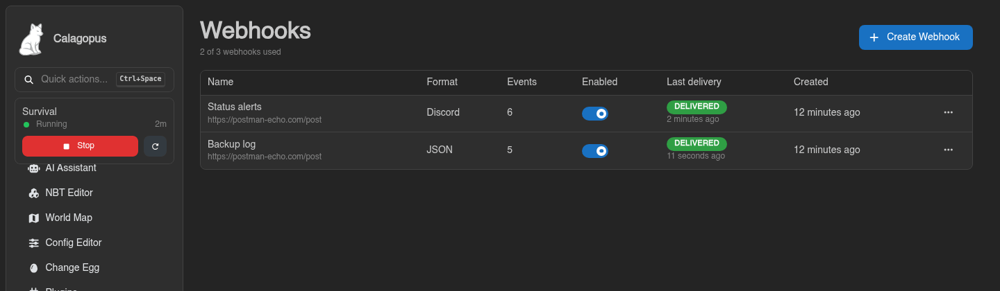
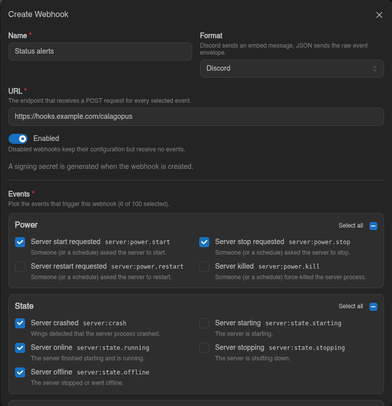
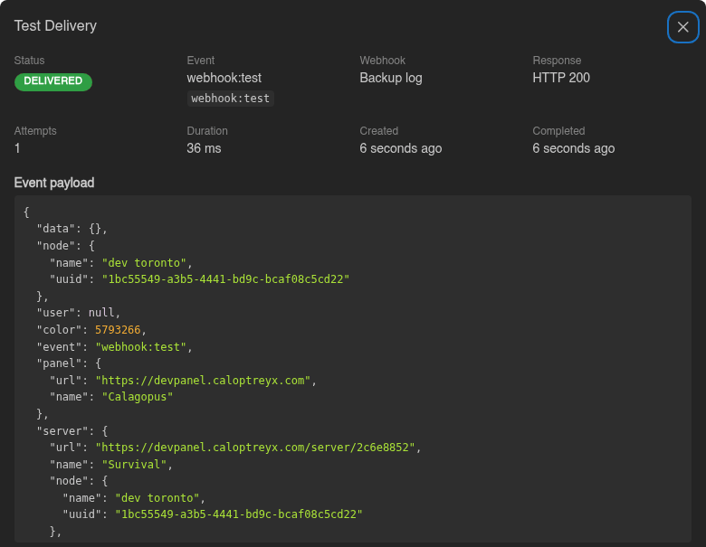
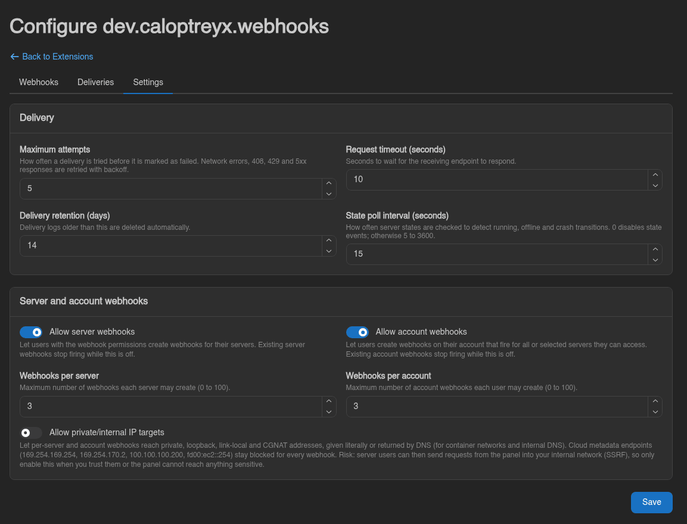

# Webhooks

A [Calagopus Panel](https://calagopus.com) extension that sends panel and server events to webhook
URLs – Discord channels, monitoring systems, automation scripts – so nothing has to poll the panel
API. Inspired by Pelican Panel's webhooks.

Package name: `dev.caloptreyx.webhooks` · Requires panel `>=1.2.10`

## Features

- **Global webhooks** managed by administrators, optionally restricted to a set of servers.
- **Per-server webhooks** managed by server owners and subusers on the server's **Webhooks** page.
- **Account webhooks** managed by every user under **Account → Webhooks**: one webhook for all of
  their servers (owned, or subuser with `webhooks.read`) or a selection of them.
- Administrators can switch per-server and account webhooks off or limit how many each server/user gets.
- **Two formats**: a ready-made **Discord** embed, or the raw **JSON** event envelope.
- **Custom body templates** (minijinja) for Slack, Teams, ntfy, Gotify, … – anything that accepts JSON.
- **Signed requests** (HMAC-SHA256) with a per-webhook secret, plus custom headers (e.g. `Authorization`).
- **Reliable delivery**: deliveries are queued in the database, retried with backoff on network
  errors, `408`, `429` (honouring `Retry-After`) and `5xx`, and kept as a searchable history with
  request/response details and a one-click **redeliver**.
- **Test button** and a **template preview** for every event.

## Screenshots

**Server webhooks**: a Discord and a JSON webhook with their last delivery.



**Create Webhook**: format, URL and the events that trigger it.



**Delivery**: status, response and the event payload of a test delivery.



**Admin settings**: delivery retries, retention, state polling and limits.



## Events

| Category | Events |
|---|---|
| Power | `server:power.start`, `server:power.stop`, `server:power.restart`, `server:power.kill` |
| State | `server:crash`, `server:state.starting`, `server:state.running`, `server:state.stopping`, `server:state.offline` |
| Installation | `server:install.started`, `server:install.completed`, `server:install.failed` |
| Backups | `server:backup.started`, `server:backup.completed`, `server:backup.failed`, `server:backup.deleted`, `server:backup.restore-started`, `server:backup.restore-completed`, `server:backup.restore-failed` |
| Transfers | `server:transfer.started`, `server:transfer.completed`, `server:transfer.failed` |
| Server | `server:suspended`, `server:unsuspended`, `server:console.command`, `server:created`*, `server:updated`*, `server:deleted`* |
| Nodes | `node:offline`*, `node:online`*, `node:state-reset`*, `node:created`*, `node:deleted`* |
| Users | `user:created`*, `user:deleted`* |
| Activity | `server:activity` (every server activity log entry), `admin:activity`* (every admin activity log entry) |

\* global (admin) webhooks only; per-server and account webhooks can pick every other event.

Notes:

- Power events cover both the panel API and the console buttons (wings). Crashes are reported by wings.
- Wings does not push server states to the panel, so `server:state.*`, `node:offline` and
  `node:online` come from polling every node (`/api/servers/utilization`) every
  *State poll interval* seconds (default 15). A state that lasts shorter than the interval can be
  missed; the first poll after startup only records a baseline. Polling only runs while a webhook
  listens to one of these events.
- Server webhooks subscribing to `server:activity` or `server:console.command` need the
  `activity.read` permission in addition to `webhooks.create`/`webhooks.update`. Any change to such a
  webhook, opening one of its activity deliveries and resending one need `activity.read` as well.
- The template preview needs `webhooks.create` or `webhooks.update` (admins: `webhooks.manage`).
- While an administrator has switched per-server or account webhooks off, webhooks of that type
  send nothing (queued retries and redeliveries included), and creating, editing, testing,
  resending, rotating the secret and previewing are refused. Users can still list, view and
  delete them.
- Account webhooks follow the user's current access: a subuser only receives events of servers where
  they hold `webhooks.read` (and `activity.read` for the two events above), and nothing while the
  account is suspended. When a server is deleted it is removed from every server filter; a webhook
  whose filter becomes empty is disabled instead of widening to all servers.

## Installation

Download `dev_caloptreyx_webhooks.c7s.zip` from the
[latest release](https://github.com/Caloptreyx/Webhooks/releases/latest) and either upload it under
**Admin → Extensions** or drop it into your heavy image's `build/extensions/` directory and
`docker compose restart web`. Extensions require the `:heavy` panel image (or a dev environment) –
see the [Calagopus docs](https://calagopus.com/docs/panel/extensions/installing-extensions).

## Configuration

**Admin → Extensions → Webhooks → Configure**

- **Webhooks** – all webhooks (global, per-server and account); create global webhooks, edit,
  enable/disable, send a test, rotate the signing secret, delete.
- **Deliveries** – the delivery log across all webhooks, filterable by webhook, event and status.
  Open a delivery to see the payload, the body that was sent, the response and to redeliver it.
- **Settings**
  - *Max attempts* (default 5) – attempts per delivery; retries back off 30 s, 2 min, 10 min, 30 min, 1 h.
  - *Request timeout* (default 10 s).
  - *History retention* (default 14 days).
  - *State poll interval* (default 15 s, `0` disables state and node reachability events).
  - *Server webhooks* on/off and *webhooks per server* (default 3).
  - *Account webhooks* on/off and *webhooks per account* (default 3).
  - *Allow private/internal IP targets* (default off) – see [Private targets](#private-targets).

Server users find their webhooks under **Webhooks** in the server sidebar, and their account
webhooks under **Account → Webhooks**.

Permissions: server `webhooks.read|create|update|delete` (users without `update` see webhooks with
the URL path, header values and secret hidden), user (API key scope) `webhooks.read|create|update|delete`,
admin `webhooks.read|manage`.

### Private targets

Every delivery's target is resolved and checked, the connection is pinned to the checked addresses
(so DNS cannot swap in another address between check and send), and redirects are never followed.

Cloud metadata endpoints are always refused, for every webhook including global (admin) ones and
whatever the settings say: `169.254.169.254` (AWS, GCP, Azure, …), `169.254.170.2` (AWS ECS task
metadata), `100.100.100.200` (Alibaba Cloud) and `fd00:ec2::254` (AWS over IPv6), also in their
IPv4-mapped (`::ffff:…`) and NAT64 (`64:ff9b::…`) forms. They hand out cloud credentials to anything
that can reach them.

Per-server and account webhooks are created by server users, and the panel sends their requests from
inside your network, so by default they may only reach public addresses. Global (admin) webhooks may
reach every other address.

If your receivers live on container networks or behind an internal DNS that returns private
addresses, enable *Allow private/internal IP targets*. Per-server and account webhooks may then reach
private (`10/8`, `172.16/12`, `192.168/16`, `fc00::/7`), loopback, link-local and carrier-grade NAT
(`100.64/10`) addresses, whether written in the URL or returned by DNS, except the metadata endpoints
above.

The tradeoff is server-side request forgery (SSRF): anyone who can create a webhook can make the panel
send POST requests to services on its internal network (databases with HTTP APIs, admin interfaces,
wings, …) and read up to 4 KiB of each response in the delivery log. Only enable it when you trust
your server users or the panel host cannot reach anything sensitive.

## Request format

Every delivery is a `POST` with `Content-Type: application/json` and these headers:

| Header | Value |
|---|---|
| `User-Agent` | `Calagopus-Webhooks/<version>` |
| `X-Webhook-Event` | event id, e.g. `server:crash` (`webhook:test` for tests) |
| `X-Webhook-Delivery` | delivery uuid (stable across retries) |
| `X-Webhook-Timestamp` | unix seconds of this attempt |
| `X-Webhook-Signature` | `sha256=<hex HMAC-SHA256(secret, "<timestamp>.<body>")>` |

The JSON format sends the event envelope:

```json
{
  "event": "server:crash",
  "event_label": "Server crashed",
  "summary": "**mc-1** crashed (exit code 137, killed by the OOM killer).",
  "severity": "danger",
  "color": 15548997,
  "timestamp": "2026-09-24T12:00:00Z",
  "panel": { "name": "Calagopus", "url": "https://panel.example.com" },
  "server": {
    "uuid": "…", "uuid_short": "5bcd4c70", "name": "mc-1",
    "url": "https://panel.example.com/server/5bcd4c70",
    "node": { "uuid": "…", "name": "node-1" },
    "owner": { "uuid": "…", "username": "bob" }
  },
  "node": { "uuid": "…", "name": "node-1" },
  "user": { "uuid": "…", "username": "alice" },
  "data": { "exit_code": 137, "oom_killed": true }
}
```

`server`, `node` and `user` are `null` when they don't apply; `user` is the actor (or the subject of
`user:*` events). `data` is event specific (`previous_state`/`state`, `backup_name`/`bytes`,
`destination_node_name`, `command`, `changed`, the activity `event`/`metadata`, …).

Verifying a signature (Python):

```python
import hashlib, hmac

def verify(secret: str, headers, body: bytes) -> bool:
    message = headers["X-Webhook-Timestamp"].encode() + b"." + body
    expected = "sha256=" + hmac.new(secret.encode(), message, hashlib.sha256).hexdigest()
    return hmac.compare_digest(expected, headers["X-Webhook-Signature"])
```

## Templates

A body template is a JSON document rendered with [minijinja](https://docs.rs/minijinja) against the
envelope. `{{ … }}` output is escaped for use inside JSON strings; use `|tojson` to embed raw JSON.
The result must be valid JSON; templates are checked against every selected event when saved.
Rendering has a work budget (minijinja fuel) and a 64 KiB output limit; a template that exceeds
either fails with an error instead of sending.

```json
{
  "text": "{{ event_label }}: {{ summary }}",
  "server": "{{ server.name if server else 'n/a' }}",
  "data": {{ data|tojson }}
}
```

"Use default template" in the editor loads the built-in Discord template as a starting point.

## API

- Admin: `/api/admin/extensions/dev.caloptreyx.webhooks/{settings,events,preview}`,
  `…/webhooks` (`GET|POST`, `GET|PATCH|DELETE /{uuid}`, `POST /{uuid}/test`, `POST /{uuid}/rotate-secret`),
  `…/deliveries` (`GET`, `GET /{uuid}`, `POST /{uuid}/redeliver`)
- Server: `/api/client/servers/{server}/webhooks` and account:
  `/api/client/extensions/dev.caloptreyx.webhooks/webhooks`, both with (`GET|POST`, `PATCH|DELETE /{uuid}`,
  `POST /{uuid}/test`, `POST /{uuid}/rotate-secret`, `GET /{uuid}/deliveries[/{delivery}]`,
  `POST /{uuid}/deliveries/{delivery}/redeliver`, `POST /preview`)

Full schemas are in the panel's OpenAPI document once installed.

## License

MIT
